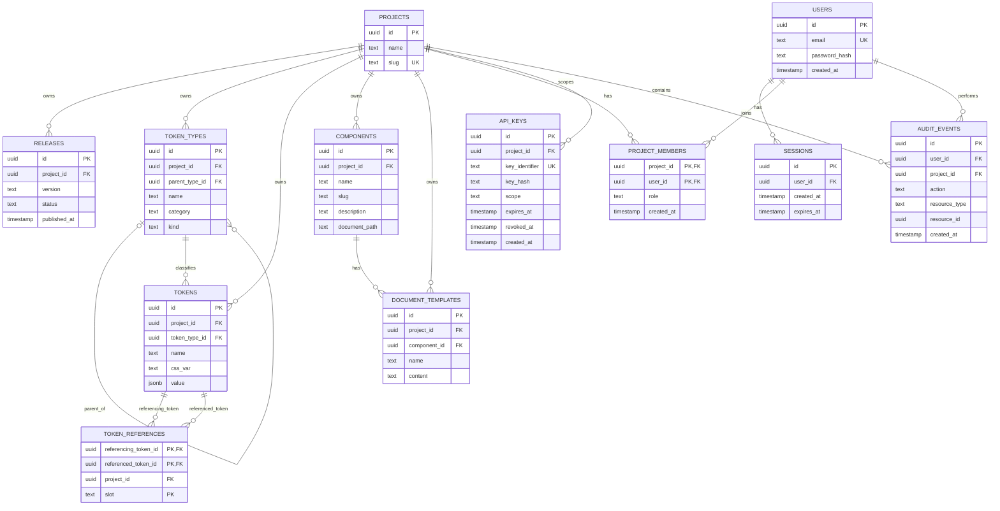

# DSO ER model

## ERD

## Cardinality and relationship notes

- A project can own zero or many to:
  - releases
  - token types
  - tokens
  - components
  - document templates
- A user can have zero or many sessions.
- A user can belong to zero or many projects through `project_members`.
- A project can have zero or many members, with at most one membership
  per user.
- A project can have zero or many project-scoped API keys.
- A user can perform zero or many audit events.
- A project can contain zero or many audit events.
- A token type can have zero or one parent token type.
- A token type can have zero or many child token types.
- A token type can classify zero or many tokens.
- A token can reference zero or many other tokens.
- A token can also be referenced by zero or many other tokens.
  - Both directions are represented by `TOKEN_REFERENCES`.
  - `referencing_token_id` is the source and `referenced_token_id` is the target.
- A component can have zero or many document templates.
  - Each document template belongs to exactly one component.

### Project membership roles

- `editor`: may edit project resources.
- `publisher`: may edit project resources and publish releases.
- `admin`: may edit project resources, publish releases, and manage API keys.

Project ownership and release-publishing permission are inferred from `project_members`; the schema does not add `projects.owner_id` or `releases.published_by`. The application records the user who performs a publish action in `audit_events`.

## Constraint enforcement

| Rule                                                         | PostgreSQL                       | Application validation | Notes                                                                                                                                           |
| ------------------------------------------------------------ | -------------------------------- | ---------------------: | ----------------------------------------------------------------------------------------------------------------------------------------------- |
| Required entity fields are present                           | Yes                              |                    Yes | Use `NOT NULL`; validate request bodies before persistence                                                                                      |
| Project-owned records reference an existing project          | Yes                              |                    Yes | Use foreign keys and authorization checks                                                                                                       |
| Release status is valid                                      | Yes                              |                    Yes | Use a `CHECK` constraint and contract validation                                                                                                |
| Release version is unique within a project                   | Yes                              |                    Yes | Use a unique constraint                                                                                                                         |
| Token type parent belongs to the same project                | Yes, preferably                  |                    Yes | Use composite foreign-key design plus request validation                                                                                        |
| A token type cannot be its own parent                        | Yes                              |                    Yes | Use a `CHECK` constraint                                                                                                                        |
| Token-type hierarchy contains no cycles                      | No, not with a simple constraint |                    Yes | Validate the proposed hierarchy before saving                                                                                                   |
| Token belongs to the same project as its token type          | Yes, preferably                  |                    Yes | Enforce with composite foreign keys and validation                                                                                              |
| Token reference points to existing tokens                    | Yes                              |                    Yes | Use foreign keys                                                                                                                                |
| Referencing and referenced tokens belong to the same project | Yes, preferably                  |                    Yes | Validate before writing; use composite keys if practical                                                                                        |
| A token cannot reference itself                              | Yes                              |                    Yes | Use a `CHECK` constraint                                                                                                                        |
| Duplicate token references are rejected                      | Yes                              |                    Yes | Primary key prevents duplicate source, target, and slot; a unique constraint also permits one target per source slot                            |
| Token value shape matches its token type                     | No                               |                    Yes | Primitive color, shadow, and typography types use `single`; semantic color/shadow types use `modes`; semantic typography types use `typography` |
| Reference slot is supported by the token value and type      | No                               |                    Yes | Requires interpreting the token's JSON value and token type                                                                                     |
| Referenced token type and value are compatible with the slot | No                               |                    Yes | Semantic color/shadow slots reference same-category primitive tokens; typography slots map to their corresponding primitive typography types    |
| Typography slot matches its primitive type                   | No                               |                    Yes | `fontSize` maps to `font-size`, `fontWeight` maps to `font-weight`, and `lineHeight` maps to `line-height`                                      |
| Component slug is valid and unique within a project          | Yes, partly                      |                    Yes | Database enforces uniqueness; application validates format                                                                                      |
| Component document path is non-empty and relative            | Basic checks                     |                    Yes | Application performs complete path validation                                                                                                   |
| Document path contains no `..` segments or unsafe separators | Limited                          |                    Yes | Normalize and validate before saving and before file generation                                                                                 |
| Document template belongs to its component and project       | Yes                              |                    Yes | Use foreign keys; validate project consistency                                                                                                  |
| Document template content is Markdown                        | No                               |                    Yes | Validate the first-release format                                                                                                               |
| User email is unique                                         | Yes                              |                    Yes | Use a unique constraint                                                                                                                         |
| Project membership is unique per user                        | Yes                              |                    Yes | The `(project_id, user_id)` primary key prevents duplicate memberships                                                                          |
| Project-member role is valid                                 | Yes                              |                    Yes | Allow `editor`, `publisher`, and `admin`                                                                                                        |
| API-key identifier is unique                                 | Yes                              |                    Yes | Use a unique constraint                                                                                                                         |
| API-key scope is valid                                       | Yes                              |                    Yes | The first release allows `release:read`                                                                                                         |
| Session and API-key expiry follow creation                   | Yes                              |                    Yes | Enforce `expires_at > created_at`                                                                                                               |
| User is authorized to modify the project                     | No                               |                    Yes | This is an application authorization rule                                                                                                       |
| Published releases contain valid complete data               | No                               |                    Yes | Validate before publishing                                                                                                                      |
| Request body has valid shape and size                        | No                               |                    Yes | Enforce through API schemas and request limits                                                                                                  |

## Planned indexes

- `releases(project_id)` list releases for a project
- `token_types(project_id)` list token types for a project
- `token_types(parent_type_id)` find child token types
- `tokens(project_id, token_type_id)` list tokens by project and type
- `token_references(referenced_token_id)` find tokens that reference a token
- `components(project_id)` list components for a project
- `document_templates(component_id)` find templates belonging to a component
