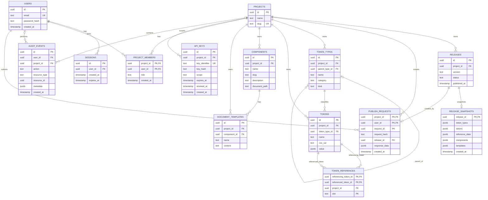

# DSO ER model

This document defines the database structure: entities, keys, and relationships.

Find relevant reads in:

- [migration verification](./migration-verification.md) for the implemented result
- [published release API contract](./published-release-api.md) for the database snapshot exposed to clients
- [workbench local development](./workbench-local-development.md) for PostgreSQL and workbench setup
- [implemented security measures](../security/implemented-security-measures.md#audit-events) for implemented security-event rules.

## ERD

## Cardinality and relationship notes

- A project owns releases, publish requests, token types, tokens, components, document templates, project memberships, API keys, and project-scoped audit events.
- A release has at most one release snapshot.
- A publish request records the durable idempotency key, payload hash, and first successful response for one publication.
- The composite primary key `(project_id, user_id, request_id)` scopes retry identity to both the project and submitting user.
- A user has zero or many sessions and project memberships.
- A project membership identifies the user's role for one project.
- A token type has zero or one parent and zero or many child token types.
- A token type classifies zero or many tokens.
- `TOKEN_REFERENCES.referencing_token_id` identifies the source token.
- `TOKEN_REFERENCES.referenced_token_id` identifies the target token.
- `TOKEN_REFERENCES.slot` distinguishes semantic or typography reference slots.
- A component has zero or many document templates.
- An audit event may belong to a user and/or a project. `resource_id` is a polymorphic identifier and is not a foreign key.
