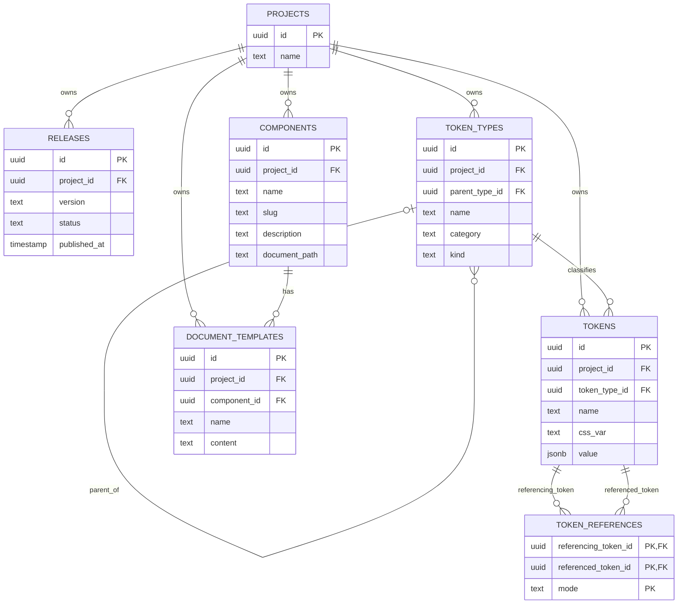

# DSO ER model

## ERD

## Cardinality and relationship notes

- A project can own zero or many to:
  - releases
  - token types
  - tokens
  - components
  - document templates
- A token type can have zero or one parent token type.
- A token type can have zero or many child token types.
- A token type can classify zero or many tokens.
- A token can reference zero or many other tokens.
- A token can also be referenced by zero or many other tokens.
  - Both directions are represented by `TOKEN_REFERENCES`.
  - `referencing_token_id` is the source and `referenced_token_id` is the target.
- A component can have zero or many document templates.
  - Each document template belongs to exactly one component.

## Constraint enforcement

| Rule                                                         |                       PostgreSQL | Application validation | Notes                                                           |
| ------------------------------------------------------------ | -------------------------------: | ---------------------: | --------------------------------------------------------------- |
| Required entity fields are present                           |                              Yes |                    Yes | Use `NOT NULL`; validate request bodies before persistence      |
| Project-owned records reference an existing project          |                              Yes |                    Yes | Use foreign keys and authorization checks                       |
| Release status is valid                                      |                              Yes |                    Yes | Use a `CHECK` constraint and contract validation                |
| Release version is unique within a project                   |                              Yes |                    Yes | Use a unique constraint                                         |
| Token type parent belongs to the same project                |                  Yes, preferably |                    Yes | Use composite foreign-key design plus request validation        |
| A token type cannot be its own parent                        |                              Yes |                    Yes | Use a `CHECK` constraint                                        |
| Token-type hierarchy contains no cycles                      | No, not with a simple constraint |                    Yes | Validate the proposed hierarchy before saving                   |
| Token belongs to the same project as its token type          |                  Yes, preferably |                    Yes | Enforce with composite foreign keys and validation              |
| Token reference points to existing tokens                    |                              Yes |                    Yes | Use foreign keys                                                |
| Referencing and referenced tokens belong to the same project |                  Yes, preferably |                    Yes | Validate before writing; use composite keys if practical        |
| A token cannot reference itself                              |                              Yes |                    Yes | Use a `CHECK` constraint                                        |
| Duplicate token references are rejected                      |                              Yes |                    Yes | Use a unique constraint on source, target, and mode             |
| Reference mode is supported by the token value               |                               No |                    Yes | Requires interpreting the token's JSON value                    |
| Component slug is valid and unique within a project          |                      Yes, partly |                    Yes | Database enforces uniqueness; application validates format      |
| Component document path is non-empty and relative            |                     Basic checks |                    Yes | Application performs complete path validation                   |
| Document path contains no `..` segments or unsafe separators |                          Limited |                    Yes | Normalize and validate before saving and before file generation |
| Document template belongs to its component and project       |                              Yes |                    Yes | Use foreign keys; validate project consistency                  |
| Document template content is Markdown                        |                               No |                    Yes | Validate the first-release format                               |
| User is authorized to modify the project                     |                               No |                    Yes | This is an application authorization rule                       |
| Published releases contain valid complete data               |                               No |                    Yes | Validate before publishing                                      |
| Request body has valid shape and size                        |                               No |                    Yes | Enforce through API schemas and request limits                  |

## Planned indexes

- `releases(project_id)` for project release lookup
- `token_types(project_id)` for project token-type lookup
- `tokens(project_id, token_type_id)` for token lookup by project and type
- `token_references(referencing_token_id)` for forward references
- `token_references(referenced_token_id)` for reverse references
- `components(project_id)` for project component lookup
- `document_templates(project_id, component_id)` for component template lookup
