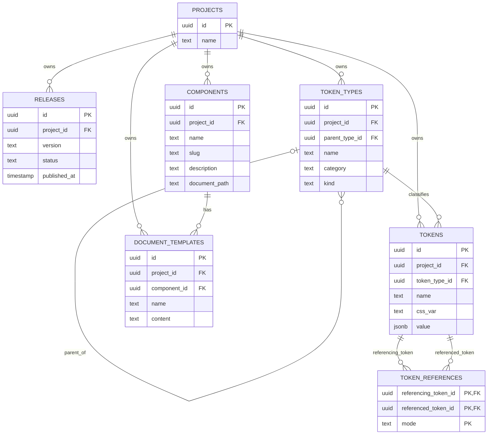

# DSO ERD draft

## Cardinality and relationship notes

- A project can own zero or many to:
  - releases
  - token types
  - tokens
  - components
  - document templates
- A token type can have zero or one parent token type.
- A token type can have zero or many child token types.
- A token type can classify zero or many tokens.
- A token can reference zero or many other tokens.
- A token can also be referenced by zero or many other tokens.
  - Both directions are represented by `TOKEN_REFERENCES`.
  - `referencing_token_id` is the source and `referenced_token_id` is the target.
- A component can have zero or many document templates.
  - Each document template belongs to exactly one component.

## Important constraints

- `parent_type_id` is a nullable self-referencing foreign key.
- A token cannot reference itself.
- Duplicate token references are rejected for the same source token, target token, and mode.
- Token-type cycles are rejected.
